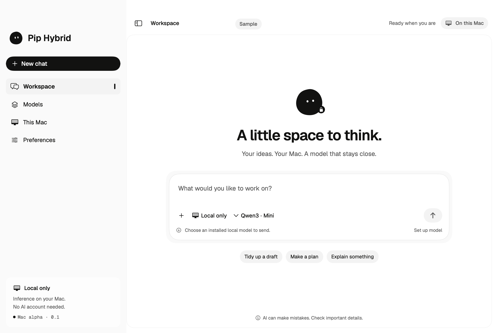

# Pip Hybrid


A native Mac workspace for local model chat, verified model downloads, Stop, encrypted saved history and an optional explicitly reviewed ChatGPT connection.

**Experimental public source.** The source is published in [Ghostzy0/pip-hybrid](https://github.com/Ghostzy0/pip-hybrid); a separate recreation experiment is [Ghostzy0/pip-hybrid-replica](https://github.com/Ghostzy0/pip-hybrid-replica). No tested public binary or installer is offered by this documentation. Source publication does not establish complete reference parity, broad hardware/provider compatibility, accessibility certification, notarisation or production readiness. Check the repository's current Releases page for any newer artifact status before sharing download claims.

[Setup with an assistant](docs/AI-SETUP.md) · [Four variants](docs/EDITIONS.md) · [Privacy](docs/PRIVACY.md) · [Testing](docs/TESTING.md) · [Release limits](docs/RELEASE.md) · [Change notes](CHANGELOG.md) · [FAQ and how-to](docs/FAQ.md)

## Build on your Mac

Requires an Apple Silicon Mac, macOS 14 or later, full Xcode with its command-line tools selected, Python 3 and sufficient free disk/memory for your chosen model. The code declares this platform range; it does not imply every supported host has been tested.

From this source checkout:

```sh
swift test --package-path apps/mac --scratch-path apps/mac/.build-baseline --jobs 4 -Xswiftc -DBASELINE_EDITION
./scripts/build-mac.sh baseline
swift test --package-path apps/mac --scratch-path apps/mac/.build-pip --jobs 4
./scripts/build-mac.sh pip
```

Outputs are `dist/Pip Hybrid Baseline.app` and `dist/Pip Hybrid.app`. The build script defaults to Pip and limits compilation to four jobs. It downloads the pinned, SHA-256-verified llama.cpp runtime when needed; it does not download model weights, connect an account or launch the app. It signs the local output ad hoc. These builds are not notarised installers. Follow macOS security prompts; do not disable system security globally.

When ready, open one build yourself. Configure a local model in Models; the smallest catalogue entry is about 639 MB, with additional memory/runtime/storage needs. Models are separate downloads with their own licences. Use synthetic prompts first. Account sign-in, native consent and reviewing any cloud request remain your actions.

## Baseline, Pip and enhanced variants

All four variants compile the same backend and workflow source. Neutral and Pip baseline are 0.1 alpha; neutral and Pip enhanced are 0.2 alpha. The two enhanced variants add local saved-chat search and deliberate current-chat Markdown export with a plaintext warning. See the exact [release/build matrix](docs/EDITIONS.md). `BASELINE_EDITION` selects system fonts, native controls, semantic colors and a static system icon. Pip selects the Paper theme and an original MIT mascot. Each variant has its own bundle ID, preferences, Application Support folder and Keychain service names; there is no automatic data, model or credential migration between them.

The baseline is an independently authored behavioral implementation on a licensed LocalSwitch foundation, inspired by aspects of [Perplexity](https://www.perplexity.ai/) as a workflow reference. It contains no proprietary Perplexity source/assets and makes no affiliation, endorsement or equivalence claim. Full workflow fidelity, web research, broad document processing and a complete hybrid task graph are not established by this alpha.

Use `./scripts/build-mac.sh baseline-plus` or `./scripts/build-mac.sh pip-plus` for enhanced packages. Run the corresponding flagged test commands in [EDITIONS](docs/EDITIONS.md) first.

## Native previews

The current Pip workspace and setup use an original MIT mascot. These native renders contain labelled synthetic state; they do not demonstrate a completed model request.



[Baseline workspace](docs/assets/baseline-workspace.png) · [Pip setup](docs/assets/pip-setup.png) · [Capture identities and limits](docs/SCREENSHOTS.md)

## About and references

Maintained by [Ghostzy0](https://github.com/Ghostzy0). Repository: [Ghostzy0/pip-hybrid](https://github.com/Ghostzy0/pip-hybrid). Release and availability claims must match the repository state you are actually reading.

Application source retains the [LocalSwitch MIT licence](LICENSE). Original Pip artwork is MIT. [llama.cpp](https://github.com/ggml-org/llama.cpp) supplies the separately downloaded runtime; [Geist](https://github.com/vercel/geist-font) supplies the licensed fonts for the Pip edition; catalogue Qwen model references retain their separate Apache-2.0 terms. See [notices](THIRD_PARTY_NOTICES.md) for exact pins and boundaries.

Real screenshots, their build identities and coverage are tracked in [the screenshot index](docs/SCREENSHOTS.md). The mascot above is artwork, not runtime evidence. [Contributing](CONTRIBUTING.md) and [security reporting](SECURITY.md) explain how to help without exposing private content.
